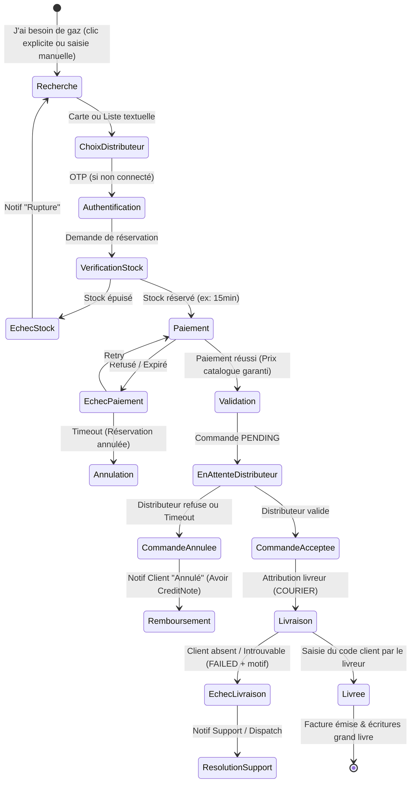
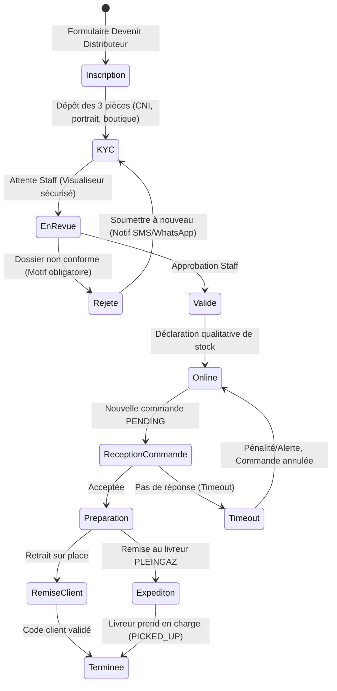
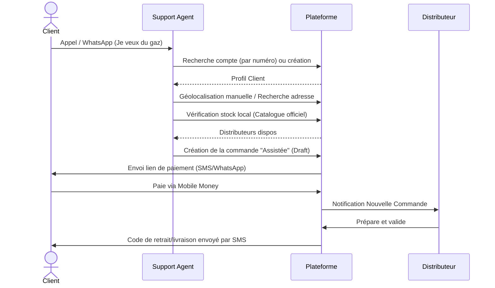
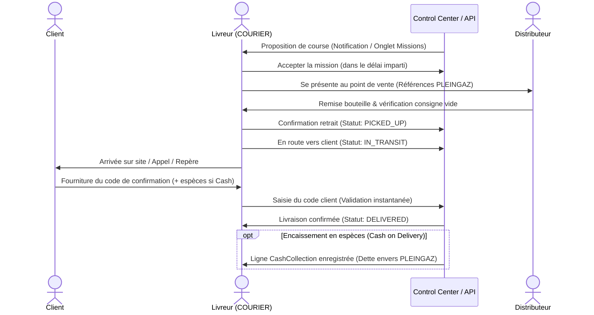

# Cadrage UX et Modèle RBAC

## 1. Sitemap et Accès (CR-003 D-11)

L'application repose sur un modèle d'accès authentifié obligatoire et d'espaces totalement cloisonnés :
- **Un numéro WhatsApp = Un seul type d'espace** (défaut opérationnel). Tout sélecteur de profil ou switch inter-espaces est formellement aboli.
- **Principe "Aucune Trace" (D-11.5, C-06)** : L'espace d'un profil ne contient aucun lien, menu ou sélecteur vers un autre profil. L'API renvoie 404 sur les routes d'un autre espace.
- **Accès du personnel (Staff)** : URL d'accès non référencée (variable d'environnement), absente des moteurs, du sitemap et de robots.txt, protégée par Mot de passe fort + TOTP obligatoire.

### 1.1 Portail Public (Visiteurs non connectés)
L'accès libre est strictement circonscrit. Le réglage système `public_discovery_enabled = false` (réversible) protège l'annuaire, la carte, le catalogue avec prix, l'assistant IA et les commandes derrière une session authentifiée :
- **Home (`/`)** : Présentation du service, comment ça marche en 3 étapes par profil, réassurance, FAQ, contacts. Accès direct vers les portails de connexion et inscription : Acheteur (`/acheteur`), Distributeur (`/distributeur`), Livreur (`/livreur`).
- **Pages Légales & Sécurité** : CGV, Mentions Légales, Politique de Confidentialité, Sécurité d'utilisation du gaz.
- **Portails de connexion / inscription / récupération** : Formulaires d'entrée dédiés par type de profil (`/acheteur/login`, `/distributeur/login`, `/livreur/login`).

### 1.2 Espace Acheteur (`/acheteur` — D-14)
*Accès authentifié par Numéro WhatsApp + Mot de passe (preuve entrante D-12).*
- **Tableau de bord** : Jauge de quota (X sur 5 bouteilles / 30 jours), bouton "J'ai besoin de gaz", mes distributeurs habituels (avec historique C-01), recherche au clic (CR-001 D-02), commande rapide, suivi animé, panneau Infos (D-18).
- **Mes Commandes** : Suivi des commandes actives, double confirmation de réception ("J'ai reçu ma commande"), historique et factures PDF immuables.
- **Mon Profil & Sécurité** : Coordonnées, repère textuel, sessions actives et déconnexion à distance.

### 1.3 Espace Distributeur (`/distributeur`)
*Accès authentifié par Numéro WhatsApp + Mot de passe (dossier validé).*
- **Tableau de bord & Stock** : Mise à jour qualitative du stock en un geste (`BON`/`MOYEN`/`FAIBLE`/`RUPTURE` — CR-001 D-01).
- **Commandes à traiter** : Préparation, remise client, expédition via livreur.
- **Mode Vente au Comptoir (D-16)** : Enregistrement des ventes physiques en boutique pour décompte dans la limite d'achat et traçabilité admin.
- **Approvisionnements** : Commandes de réassort passées directement à PLEINGAZ.
- **Mon Équipe** : Gestion des comptes nominatifs individuels des employés de la boutique (aucun compte partagé).
- **Mes Finances** : Relevé personnel en lecture seule (ventes, reversements reçus).

### 1.4 Espace Livreur (`/livreur` — D-17)
*Interface mobile dédiée PWA ultra-légère (rôle COURIER).*
- **Missions** : Courses proposées (acceptation/refus sous timeout), mission en cours (adresse, repère textuel, contact masqué WhatsApp/appel).
- **Actions Logistiques** : Prise en charge (`PICKED_UP`), en route (`IN_TRANSIT`), double confirmation ("J'ai livré" D-17), échec motivé (`FAILED`).
- **Mes Gains & Caisse** : Suivi des courses effectuées, calcul des gains et solde des espèces collectées détenues (dette envers PLEINGAZ, plafond `Setting`).
- **Mes Tarifs** : Configuration des tarifs par zone/distance dans les bornes fixées par l'admin (pour livreurs non-PLEINGAZ).

### 1.5 Portail Staff & Control Center (`/<STAFF_PORTAL_ROUTE>`)
*Accès sécurisé réservé au personnel habilité PLEINGAZ (Mot de passe + TOTP obligatoire).*
- **Supervision Générale** : 15 rapports d'activité sur données 100% réelles (CR-001 D-03).
- **Réseau Distributeurs (`DISTRIBUTOR_MANAGER`)** : Instruction des dossiers KYC 3 pièces (D-04), agréments, alertes d'écarts de stock.
- **Logistique Flotte (`LOGISTICS_MANAGER`)** : Dispatching assisté, suivi des livreurs, réconciliations caisses espèces.
- **Finances (`FINANCE_MANAGER`, `ADMIN`)** : Grand livre immuable, barèmes Maker-Checker, approbation des lots de reversements.
- **Gestion des Comptes (`ACCOUNT_MANAGER` — D-15)** : Traitement des dossiers d'assistance (`AccountCase`), déverrouillages, préparation de changements de numéro sans usurpation.
- **Annonces & Communication (`ADMIN`)** : Publication et ciblage des annonces du module Infos (D-18).
- **Super-Administration (`SUPER_ADMIN`)** : Matrice des rôles, paramètres système `Setting`.

### 1.6 Navigation Mobile Dédiée par Espace (Aucune Trace)
Chaque espace dispose de sa propre barre de navigation inférieure ou menu tiroir restreint à 5 entrées maximum, sans aucun lien vers les autres profils :
- **Acheteur** : Accueil, Trouver du gaz, Mes commandes, Mes factures, Aide.
- **Distributeur** : Tableau de bord, Stock, Commandes, Comptoir, Paramètres boutique.
- **Livreur** : Missions, Disponibilité, Caisse & Gains, Profil.

---

## 2. Parcours Utilisateurs (Diagrammes)

### 2.1 Parcours Client (Recherche et Commande)
Ce parcours inclut la gestion des échecs (stock épuisé, refus de paiement, échec de livraison).
*Note CR-001 (D-02, D-05) : La recherche ne sollicite la position qu'au clic explicite avec gestion des 8 états IHM ([12-cr001-specifications.md §2](file:///home/durel/pleingaz/docs/12-cr001-specifications.md#L64-L106)). La remise de la livraison requiert obligatoirement la saisie par le livreur du code de confirmation confidentiel fourni au client.*

### 2.2 Parcours Distributeur (Inscription et Opérations)
Gestion du dossier, y compris les rejets et l'expiration des commandes.
*Note CR-001 (D-01, D-04) : Dossier KYC restreint strictement aux 3 pièces (CNI recto/verso, photo portrait, photo boutique extérieure). Gestion de stock qualitative exclusive (`BON`/`MOYEN`/`FAIBLE`/`RUPTURE`) sur les références du catalogue officiel PLEINGAZ.*

### 2.3 Parcours Commande Assistée (Téléphone/WhatsApp)
Le client contacte le support car il n'a pas internet ou n'arrive pas à commander.

### 2.4 Parcours Livreur — Opérations Logistiques (CR-001 D-05)
Le livreur utilise une interface mobile dédiée très légère (`/courier`).

---

## 3. Matrice des Rôles et Permissions (RBAC) (CR-003 D-15, C-07)

Le système repose sur un modèle RBAC complet articulé autour de **10 rôles métier** : `CUSTOMER`, `DISTRIBUTOR_STAFF`, `DISTRIBUTOR_OWNER`, `COURIER`, `SUPPORT_AGENT`, `LOGISTICS_MANAGER`, `DISTRIBUTOR_MANAGER`, `FINANCE_MANAGER`, `ACCOUNT_MANAGER`, `SUPER_ADMIN` (avec délégation opérationnelle `ADMIN`).
Le moteur d'autorisation vérifie exclusivement des permissions granulaires affectées en base de données (`RolePermission`), sans coder de rôles en dur dans la logique applicative.

**Règles de visibilité, de cloisonnement et d'audit :**
- Un client, distributeur ou livreur ne voit que les ressources lui appartenant (suffixe `:own`).
- Le distributeur ne voit du client que le strict nécessaire pour la remise/livraison (Nom, Téléphone masqué ou redirigé, Adresse, Repère).
- `document:view_identity` (pièces d'identité KYC) est ultra-restreint (`DISTRIBUTOR_MANAGER`, `ADMIN`) et l'accès est tracé dans l'Audit Log avec génération d'URL signées éphémères (15 min).
- Les actions financières sensibles (barèmes, prix, lots de reversement) appliquent obligatoirement le principe **Maker-Checker** (proposé par `FINANCE_MANAGER`, approuvé par `ADMIN`/`SUPER_ADMIN`).
- **Gestionnaire de Compte (`ACCOUNT_MANAGER` — D-15, C-07)** : Intervient **exclusivement** sous couvert d'un dossier ouvert (`AccountCase`). Ne peut ni modifier directement un profil, ni réinitialiser un mot de passe à la place de l'utilisateur, ni usurper une identité (« voir comme »). Toute mutation sensible (changement de numéro) est une demande préparée soumise à double validation par un `ADMIN`.
- Toute action sensible génère un enregistrement immuable dans `AuditLog`.

### 3.1 Catalogue des Permissions Granulaires (Extrait Structuré)

| Domaine | Permission | Description |
|---|---|---|
| **User** | `user:view_own` / `user:view_any` | Consulter son propre profil / tous les profils (complets) |
| **Catalog** | `catalog:manage` | Gérer le catalogue exclusif PLEINGAZ (Admin) |
| **Store** | `store:update_stock` | Déclarer l'état qualitatif des stocks (`BON`/`MOYEN`/`FAIBLE`/`RUPTURE`) |
| **Store** | `store:manage_staff` | Gérer les sous-comptes du personnel de la boutique |
| **Order** | `order:create_own` / `order:process` | Passer commande / Traiter une commande (distributeur) |
| **Order** | `order:create_any` | Créer une commande assistée pour un tiers (Support) |
| **Logistics** | `courier:view_assigned` | Voir les courses assignées au livreur connecté |
| **Logistics** | `courier:update_delivery_status` | Avancer l'état de livraison (`PICKED_UP`, `IN_TRANSIT`, `DELIVERED`, `FAILED`) |
| **Logistics** | `courier:set_availability` | Activer/Désactiver son statut en ligne |
| **Logistics** | `courier:manage` / `delivery:assign` | Gérer les livreurs / Assigner des courses (Staff) |
| **Finance** | `price:propose` / `price:approve` | Proposer un barème de prix / Approuver un barème (Maker-Checker) |
| **Finance** | `fee:propose` / `fee:approve` | Proposer les commissions & frais / Les approuver (Maker-Checker) |
| **Finance** | `payout:create` / `payout:approve` | Créer un lot de reversement / Valider le lot (Maker-Checker) |
| **Finance** | `payout:execute` | Marquer un reversement comme exécuté avec justificatif |
| **Finance** | `payment:refund` | Émettre un remboursement avec création d'avoir `CreditNote` |
| **Finance** | `ledger:view` / `cash:reconcile` | Consulter le grand livre complet / Rapprocher les caisses espèces |
| **Reporting** | `report:view_finance` / `report:view_analytics` | Accéder aux 15 rapports du Control Center |
| **Admin** | `distributor:approve` / `distributor:suspend` | Valider (KYC 3 pièces) ou suspendre un distributeur |
| **Admin** | `document:view_identity` | Consulter les pièces d'identité KYC (URL signée 15 min, action auditée) |
| **Admin** | `announcement:publish` | Créer et publier des annonces ciblées du module Infos (D-18) |
| **Account** | `account:view_masked` | Consulter un profil avec numéros masqués (Gestionnaire de compte) |
| **Account** | `account:unmask_phone` | Démasquer un numéro sur motif obligatoire consigné dans `AuditLog` |
| **Account** | `account:unlock` | Lever le verrouillage temporaire d'un compte après vérification |
| **Account** | `account:revoke_sessions` | Déconnecter à distance les sessions d'un compte compromis |
| **Account** | `account_case:manage` | Créer, instruire et clôturer un dossier d'assistance `AccountCase` |
| **Account** | `account:prepare_phone_change` | Préparer une demande de changement de numéro (soumise à `ADMIN`) |
| **Admin** | `account:approve_phone_change` | Valider formellement un changement de numéro de secours (Double validation) |
| **Admin** | `system:manage_roles` | Gérer les rôles et permissions dynamiques (Super Admin) |

### 3.2 Matrice Rôles × Permissions Principales

| Permission | CUSTOMER | DIST_STAFF | DIST_OWNER | COURIER | SUPPORT | LOGISTICS_MGR | DISTRIB_MGR | FINANCE_MGR | ACCOUNT_MGR | ADMIN / SUPER_ADMIN |
|---|:---:|:---:|:---:|:---:|:---:|:---:|:---:|:---:|:---:|:---:|
| `user:view_own` | ✅ | ✅ | ✅ | ✅ | ✅ | ✅ | ✅ | ✅ | ✅ | ✅ |
| `store:update_stock` | ❌ | ✅ | ✅ | ❌ | ❌ | ❌ | ❌ | ❌ | ❌ | ✅ |
| `store:manage_staff` | ❌ | ❌ | ✅ | ❌ | ❌ | ❌ | ❌ | ❌ | ❌ | ✅ |
| `order:create_own` | ✅ | ❌ | ❌ | ❌ | ❌ | ❌ | ❌ | ❌ | ❌ | ✅ |
| `order:process` | ❌ | ✅ | ✅ | ❌ | ❌ | ❌ | ❌ | ❌ | ❌ | ✅ |
| `order:create_any` | ❌ | ❌ | ❌ | ❌ | ✅ | ❌ | ❌ | ❌ | ❌ | ✅ |
| `courier:view_assigned` | ❌ | ❌ | ❌ | ✅ | ❌ | ❌ | ❌ | ❌ | ❌ | ✅ |
| `courier:update_delivery_status` | ❌ | ❌ | ❌ | ✅ | ❌ | ❌ | ❌ | ❌ | ❌ | ✅ |
| `courier:manage` / `delivery:assign` | ❌ | ❌ | ❌ | ❌ | ❌ | ✅ | ❌ | ❌ | ❌ | ✅ |
| `document:view_identity` | ❌ | ❌ | ❌ | ❌ | ❌ | ❌ | ✅ | ❌ | ❌ | ✅ |
| `distributor:approve` | ❌ | ❌ | ❌ | ❌ | ❌ | ❌ | ✅ | ❌ | ❌ | ✅ |
| `price:propose` / `fee:propose` | ❌ | ❌ | ❌ | ❌ | ❌ | ❌ | ❌ | ✅ | ❌ | ❌ |
| `price:approve` / `fee:approve` | ❌ | ❌ | ❌ | ❌ | ❌ | ❌ | ❌ | ❌ | ❌ | ✅ |
| `payout:create` | ❌ | ❌ | ❌ | ❌ | ❌ | ❌ | ❌ | ✅ | ❌ | ❌ |
| `payout:approve` | ❌ | ❌ | ❌ | ❌ | ❌ | ❌ | ❌ | ❌ | ❌ | ✅ |
| `payout:execute` | ❌ | ❌ | ❌ | ❌ | ❌ | ❌ | ❌ | ✅ | ❌ | ✅ |
| `ledger:view` / `cash:reconcile` | ❌ | ❌ | ❌ | ❌ | ❌ | ❌ | ❌ | ✅ | ❌ | ✅ |
| `account:view_masked` | ❌ | ❌ | ❌ | ❌ | ❌ | ❌ | ❌ | ❌ | ✅ | ✅ |
| `account:unlock` / `account:revoke_sessions` | ❌ | ❌ | ❌ | ❌ | ❌ | ❌ | ❌ | ❌ | ✅ | ✅ |
| `account:prepare_phone_change` | ❌ | ❌ | ❌ | ❌ | ❌ | ❌ | ❌ | ❌ | ✅ | ❌ |
| `account:approve_phone_change` | ❌ | ❌ | ❌ | ❌ | ❌ | ❌ | ❌ | ❌ | ❌ | ✅ |
| `announcement:publish` | ❌ | ❌ | ❌ | ❌ | ❌ | ❌ | ❌ | ❌ | ❌ | ✅ |
| `report:view_finance` | ❌ | ❌ | ❌ | ❌ | ❌ | ❌ | ❌ | ✅ | ❌ | ✅ |
| `system:manage_roles` | ❌ | ❌ | ❌ | ❌ | ❌ | ❌ | ❌ | ❌ | ❌ | ✅ (SUPER_ADMIN) |

### 3.3 Articulation des 10 Rôles Métier
1. **`CUSTOMER`** : Acheteur final (recherche au clic ou manuelle, commande de bouteilles, suivi animé, double confirmation).
2. **`DISTRIBUTOR_STAFF`** : Vendeur en boutique (mise à jour du stock qualitatif, enregistrement des ventes au comptoir D-16).
3. **`DISTRIBUTOR_OWNER`** : Gérant titulaire (gestion des sous-comptes employés, relevé financier en lecture seule).
4. **`COURIER`** : Livreur rattaché à la plateforme (interface PWA dédiée, missions assignées, double confirmation "J'ai livré", encaissements espèces).
5. **`SUPPORT_AGENT`** : Agent de relation client (saisie de commandes assistées, réponse aux réclamations d'orientation, gestion des litiges).
6. **`LOGISTICS_MANAGER`** : Régulateur logistique (dispatching des courses, équilibrage des zones, gestion de la flotte de livreurs).
7. **`DISTRIBUTOR_MANAGER`** : Responsable du réseau de distribution (instruction des dossiers KYC 3 pièces, agréments, détection des écarts approvisionnement/ventes).
8. **`FINANCE_MANAGER`** : Responsable financier (propositions tarifaires, création des lots de reversements Maker, contrôle du grand livre).
9. **`ACCOUNT_MANAGER` (D-15, C-07)** : Gestionnaire des accès et comptes utilisateurs (résolution des pertes de numéros, déverrouillages, dossiers `AccountCase` sans droits de modification directe).
10. **`SUPER_ADMIN`** (et délégation `ADMIN`) : Direction générale et administration centrale (approbation Maker-Checker, validation finale des changements de numéros, gestion des rôles).

---

## 4. Décisions du Propriétaire et Points Résolus (CR-001)

Les décisions souveraines du propriétaire (`D-01` à `D-06`) ont tranché plusieurs points majeurs d'architecture :
1. **Catalogue & Prix** : Catalogue strictement restreint à la marque PLEINGAZ ; prix centralisés recalculés par le serveur ; marketplace écartée (CR-001 D-01).
2. **Localisation & Ergonomie** : Aucun tracking au chargement ; géolocalisation déclenchée uniquement au clic avec mention de transparence ; primauté du choix manuel (CR-001 D-02).
3. **Reporting & Vérité Terrain** : 15 rapports exhaustifs réservés au Control Center basés à 100% sur des chiffres réels en base de données ; zéro donnée fictive en production (CR-001 D-03).
4. **Simplification KYC** : Dossier distributeur borné à 3 pièces (CNI, portrait, boutique) sans registre de commerce ni documents administratifs ; stockage privé et URL signées 15 min (CR-001 D-04).
5. **Intégration Logistique** : Livreur élevé au rang de rôle de première classe (`COURIER`) avec validation par code de confirmation client et suivi des espèces (CR-001 D-05).
6. **Rigueur Financière** : Séparation des tâches Maker-Checker, grand livre immuable à double entrée, déblocage des reversements sur preuve d'exécution (CR-001 D-06).

Les points d'implémentation opérationnelle (délais d'acceptation, plafonds de caisse) sont configurables via la table centrale `Setting` avec les valeurs par défaut définies dans [12-cr001-specifications.md](file:///home/durel/pleingaz/docs/12-cr001-specifications.md).

