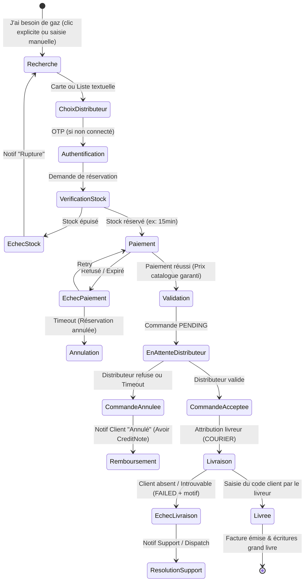
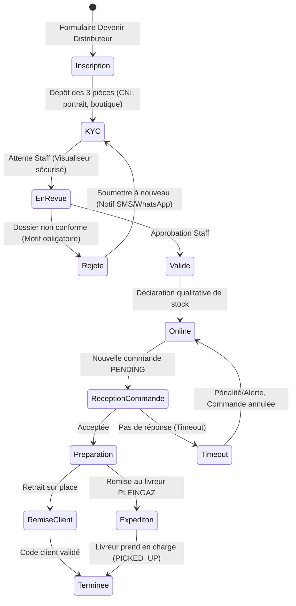
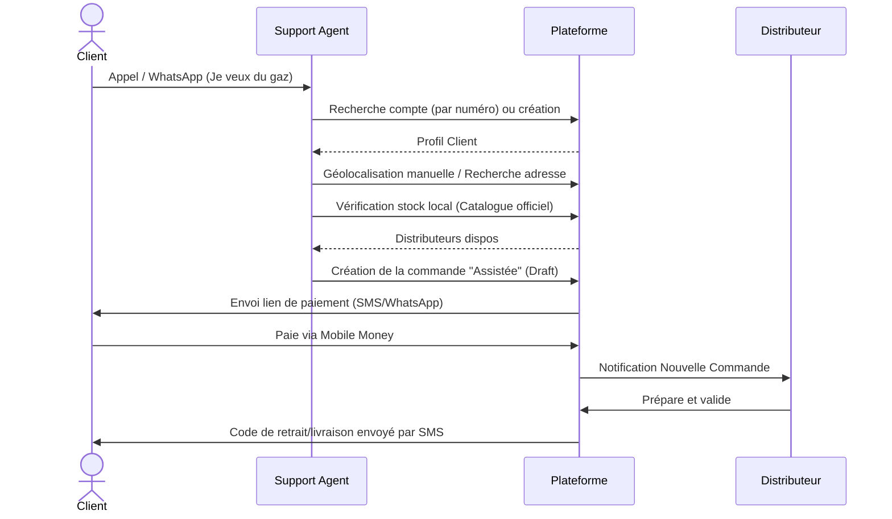
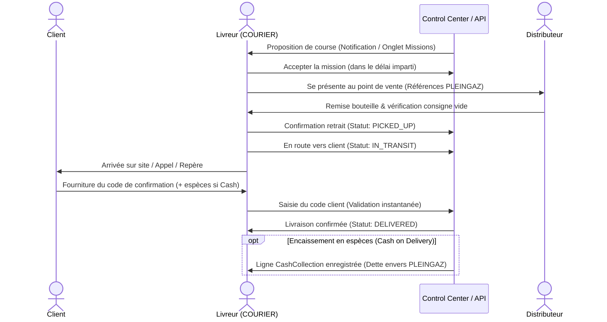

# Cadrage UX et Modèle RBAC

## 1. Sitemap et Accès

L'application repose sur un modèle d'authentification centralisé : un seul compte (numéro de téléphone) permettant d'accéder à différents profils via un sélecteur d'espace.

### 1.1 Portail Public (Visiteurs non connectés)
Ces pages sont accessibles librement. L'inscription (via OTP SMS/WhatsApp) n'est exigée qu'au moment de valider une action engageante (réserver, commander).
- **Home** : Présentation du service.
- **J'ai besoin de gaz** : Carte/liste des points de vente à proximité et recherche.
- **Devenir distributeur** : Formulaire de pré-inscription pour les commerçants.
- **Products & Services** : Vitrine (Données réelles À CONFIRMER).
- **About / FAQ / Blog / Contact** : Contenus informatifs existants.
- **Sécurité d'utilisation du gaz** : Bonnes pratiques et urgences (Contenu à fournir par PLEINGAZ).
- **Mentions légales, CGV, Confidentialité** : Pages légales obligatoires (Textes À CONFIRMER).

### 1.2 Espace Client (Authentification par OTP)
- **Tableau de bord** : Résumé des commandes en cours.
- **Mes Commandes** : Historique et factures.
- **Mon Profil & Adresses** : Gestion des informations personnelles et repères de livraison.

### 1.3 Espace Distributeur (Authentification par OTP)
- **Ma Boutique** : Horaires, localisation, statut d'ouverture.
- **Mes Stocks** : Déclaration qualitative de l'état des stocks (`BON`/`MOYEN`/`FAIBLE`/`RUPTURE`) exclusivement sur les références du catalogue PLEINGAZ distribuées (CR-001 D-01).
- **Gestion des Commandes** : Réception, préparation et remise/livraison des commandes locales.
- **Mon Équipe** : Gestion des sous-comptes pour le personnel de la boutique.
- **Mes Finances** : Relevé personnel en lecture seule (ventes, commissions prélevées, reversements reçus — CR-001 D-03, D-06).

### 1.4 Control Center Admin (Staff PLEINGAZ)
*L'accès au staff exige obligatoirement Mot de passe + TOTP (Authenticator). L'OTP simple est interdit pour le staff.*
- **Vue Globale & Pilotage** : 15 rapports exhaustifs sur données 100% réelles (zéro fictif, états vides explicites — CR-001 D-03).
- **Gestion Distributeurs** : Validation KYC à 3 pièces exclusives (CNI, portrait, boutique — CR-001 D-04), suspension.
- **Supervision Logistique & Livreurs** : Attribution manuelle assistée, suivi des livraisons, suivi des espèces en circulation (CR-001 D-05).
- **Finances & Trésorerie** : Grand livre à double entrée immuable, barèmes versionnés, lots de reversement Maker-Checker (CR-001 D-06).
- **Support & Commandes** : Saisie de commandes assistées, annulations d'urgence, remboursements LATE_SUCCESS.
- **Gestion des Rôles** : Affectation des permissions granulaires sur 9 rôles.

### 1.5 Espace Livreur (Authentification par OTP - Rôle COURIER)
*(CR-001 D-05 — Interface mobile légère et mode hors ligne partiel)*
- **Missions** : Liste des courses assignées ("À faire").
- **Détail Mission** : Adresse avec repère, point carte, références PLEINGAZ, échange consigne, contact masqué / appel / WhatsApp.
- **Actions Logistiques** : Accepter / Refuser, `PICKED_UP`, `IN_TRANSIT`, `DELIVERED` (saisie code client obligatoire), `FAILED` (motif obligatoire).
- **Mes Gains & Caisse** : Suivi des rémunérations et total des espèces collectées détenues.

### 1.6 Navigation Mobile (Menu Hamburger ~6 entrées)
1. Trouver du gaz (Carte/Recherche au clic ou manuelle — CR-001 D-02)
2. Mes Commandes
3. Mon Profil
4. Devenir Distributeur (KYC simplifié 3 pièces — CR-001 D-04)
5. Sécurité & Urgences
6. Contact & Support

---

## 2. Parcours Utilisateurs (Diagrammes)

### 2.1 Parcours Client (Recherche et Commande)
Ce parcours inclut la gestion des échecs (stock épuisé, refus de paiement, échec de livraison).
*Note CR-001 (D-02, D-05) : La recherche ne sollicite la position qu'au clic explicite avec gestion des 8 états IHM ([12-cr001-specifications.md §2](file:///home/durel/pleingaz/docs/12-cr001-specifications.md#L64-L106)). La remise de la livraison requiert obligatoirement la saisie par le livreur du code de confirmation confidentiel fourni au client.*

### 2.2 Parcours Distributeur (Inscription et Opérations)
Gestion du dossier, y compris les rejets et l'expiration des commandes.
*Note CR-001 (D-01, D-04) : Dossier KYC restreint strictement aux 3 pièces (CNI recto/verso, photo portrait, photo boutique extérieure). Gestion de stock qualitative exclusive (`BON`/`MOYEN`/`FAIBLE`/`RUPTURE`) sur les références du catalogue officiel PLEINGAZ.*

### 2.3 Parcours Commande Assistée (Téléphone/WhatsApp)
Le client contacte le support car il n'a pas internet ou n'arrive pas à commander.

### 2.4 Parcours Livreur — Opérations Logistiques (CR-001 D-05)
Le livreur utilise une interface mobile dédiée très légère (`/courier`).

---

## 3. Matrice des Rôles et Permissions (RBAC)

Le système repose sur un modèle RBAC complet articulé autour de **9 rôles** : `CUSTOMER`, `DISTRIBUTOR_STAFF`, `DISTRIBUTOR_OWNER`, `COURIER`, `SUPPORT_AGENT`, `LOGISTICS_MANAGER`, `DISTRIBUTOR_MANAGER`, `FINANCE_MANAGER`, `SUPER_ADMIN` (avec délégation opérationnelle `ADMIN`).
Le moteur d'autorisation vérifie exclusivement des permissions granulaires affectées en base de données (`RolePermission`), sans jamais coder de rôles en dur dans la logique applicative.

**Règles de visibilité, de cloisonnement et d'audit :**
- Un client, distributeur ou livreur ne voit que les ressources lui appartenant (suffixe `:own`).
- Le distributeur ne voit du client que le strict nécessaire pour la remise/livraison (Nom, Téléphone masqué ou redirigé, Adresse, Repère).
- `document:view_identity` (pièces d'identité KYC) est ultra-restreint et l'accès est tracé dans l'Audit Log avec génération d'URL signées éphémères (15 min).
- Les actions financières sensibles (barèmes, prix, lots de reversement) appliquent obligatoirement le principe **Maker-Checker** (proposé par `FINANCE_MANAGER`, approuvé par `ADMIN`/`SUPER_ADMIN`).
- Toute action sensible génère un enregistrement immuable dans `AuditLog`.

### 3.1 Catalogue des Permissions Granulaires (Extrait Structuré)

| Domaine | Permission | Description |
|---|---|---|
| **User** | `user:view_own` / `user:view_any` | Consulter son propre profil / tous les profils |
| **Catalog** | `catalog:manage` | Gérer le catalogue exclusif PLEINGAZ (Admin) |
| **Store** | `store:update_stock` | Déclarer l'état qualitatif des stocks (`BON`/`MOYEN`/`FAIBLE`/`RUPTURE`) |
| **Store** | `store:manage_staff` | Gérer les sous-comptes du personnel de la boutique |
| **Order** | `order:create_own` / `order:process` | Passer commande / Traiter une commande (distributeur) |
| **Order** | `order:create_any` | Créer une commande assistée pour un tiers (Support) |
| **Logistics** | `courier:view_assigned` | Voir les courses assignées au livreur connecté |
| **Logistics** | `courier:update_delivery_status` | Avancer l'état de livraison (`PICKED_UP`, `IN_TRANSIT`, `DELIVERED`, `FAILED`) |
| **Logistics** | `courier:set_availability` | Activer/Désactiver son statut en ligne |
| **Logistics** | `courier:manage` / `delivery:assign` | Gérer les livreurs / Assigner des courses (Staff) |
| **Finance** | `price:propose` / `price:approve` | Proposer un barème de prix / Approuver un barème (Maker-Checker) |
| **Finance** | `fee:propose` / `fee:approve` | Proposer les commissions & frais / Les approuver (Maker-Checker) |
| **Finance** | `payout:create` / `payout:approve` | Créer un lot de reversement / Valider le lot (Maker-Checker) |
| **Finance** | `payout:execute` | Marquer un reversement comme exécuté avec justificatif |
| **Finance** | `payment:refund` | Émettre un remboursement avec création d'avoir `CreditNote` |
| **Finance** | `ledger:view` / `cash:reconcile` | Consulter le grand livre complet / Rapprocher les caisses espèces |
| **Reporting** | `report:view_finance` / `report:view_analytics` | Accéder aux 15 rapports du Control Center |
| **Admin** | `distributor:approve` / `distributor:suspend` | Valider (KYC 3 pièces) ou suspendre un distributeur |
| **Admin** | `document:view_identity` | Consulter les pièces d'identité KYC (URL signée 15 min, action auditée) |
| **Admin** | `system:manage_roles` | Gérer les rôles et permissions dynamiques (Super Admin) |

### 3.2 Matrice Rôles × Permissions Principales

| Permission | CUSTOMER | DIST_STAFF | DIST_OWNER | COURIER | SUPPORT | LOGISTICS_MGR | DISTRIB_MGR | FINANCE_MGR | ADMIN / SUPER_ADMIN |
|---|:---:|:---:|:---:|:---:|:---:|:---:|:---:|:---:|:---:|
| `user:view_own` | ✅ | ✅ | ✅ | ✅ | ✅ | ✅ | ✅ | ✅ | ✅ |
| `store:update_stock` | ❌ | ✅ | ✅ | ❌ | ❌ | ❌ | ❌ | ❌ | ✅ |
| `store:manage_staff` | ❌ | ❌ | ✅ | ❌ | ❌ | ❌ | ❌ | ❌ | ✅ |
| `order:create_own` | ✅ | ❌ | ❌ | ❌ | ❌ | ❌ | ❌ | ❌ | ✅ |
| `order:process` | ❌ | ✅ | ✅ | ❌ | ❌ | ❌ | ❌ | ❌ | ✅ |
| `order:create_any` | ❌ | ❌ | ❌ | ❌ | ✅ | ❌ | ❌ | ❌ | ✅ |
| `courier:view_assigned` | ❌ | ❌ | ❌ | ✅ | ❌ | ❌ | ❌ | ❌ | ✅ |
| `courier:update_delivery_status` | ❌ | ❌ | ❌ | ✅ | ❌ | ❌ | ❌ | ❌ | ✅ |
| `courier:manage` / `delivery:assign` | ❌ | ❌ | ❌ | ❌ | ❌ | ✅ | ❌ | ❌ | ✅ |
| `document:view_identity` | ❌ | ❌ | ❌ | ❌ | ❌ | ❌ | ✅ | ❌ | ✅ |
| `distributor:approve` | ❌ | ❌ | ❌ | ❌ | ❌ | ❌ | ✅ | ❌ | ✅ |
| `price:propose` / `fee:propose` | ❌ | ❌ | ❌ | ❌ | ❌ | ❌ | ❌ | ✅ | ❌ |
| `price:approve` / `fee:approve` | ❌ | ❌ | ❌ | ❌ | ❌ | ❌ | ❌ | ❌ | ✅ |
| `payout:create` | ❌ | ❌ | ❌ | ❌ | ❌ | ❌ | ❌ | ✅ | ❌ |
| `payout:approve` | ❌ | ❌ | ❌ | ❌ | ❌ | ❌ | ❌ | ❌ | ✅ |
| `payout:execute` | ❌ | ❌ | ❌ | ❌ | ❌ | ❌ | ❌ | ✅ | ✅ |
| `ledger:view` / `cash:reconcile` | ❌ | ❌ | ❌ | ❌ | ❌ | ❌ | ❌ | ✅ | ✅ |
| `report:view_finance` | ❌ | ❌ | ❌ | ❌ | ❌ | ❌ | ❌ | ✅ | ✅ |
| `system:manage_roles` | ❌ | ❌ | ❌ | ❌ | ❌ | ❌ | ❌ | ❌ | ✅ (SUPER_ADMIN) |

### 3.3 Articulation des 9 Rôles Métier
1. **`CUSTOMER`** : Acheteur final (recherche de points de vente au clic ou manuelle, commande, suivi, code de confirmation).
2. **`DISTRIBUTOR_STAFF`** : Vendeur en boutique (déclaration qualitative de stock, remise des commandes).
3. **`DISTRIBUTOR_OWNER`** : Titulaire de la boutique (gestion de l'équipe, relevé financier personnel en lecture seule).
4. **`COURIER`** : Livreur indépendant de la plateforme (interface mobile dédiée, courses assignées, validation par code client, suivi caisse espèces).
5. **`SUPPORT_AGENT`** : Agent de service client (saisie de commandes assistées, recherche et orientation des clients, aide aux incidents).
6. **`LOGISTICS_MANAGER`** : Superviseur logistique (attribution et réattribution des courses, gestion de la flotte de livreurs).
7. **`DISTRIBUTOR_MANAGER`** : Responsable du réseau de distribution (instruction des dossiers KYC 3 pièces, agrément et suivi des points de vente).
8. **`FINANCE_MANAGER`** : Responsable financier (propositions tarifaires, création des lots de reversement, réconciliation grand livre et caisse espèces).
9. **`SUPER_ADMIN`** (et délégation `ADMIN`) : Direction générale et administration centrale (approbation Maker-Checker des barèmes et reversements, gestion des rôles et sécurité).

---

## 4. Décisions du Propriétaire et Points Résolus (CR-001)

Les décisions souveraines du propriétaire (`D-01` à `D-06`) ont tranché plusieurs points majeurs d'architecture :
1. **Catalogue & Prix** : Catalogue strictement restreint à la marque PLEINGAZ ; prix centralisés recalculés par le serveur ; marketplace écartée (CR-001 D-01).
2. **Localisation & Ergonomie** : Aucun tracking au chargement ; géolocalisation déclenchée uniquement au clic avec mention de transparence ; primauté du choix manuel (CR-001 D-02).
3. **Reporting & Vérité Terrain** : 15 rapports exhaustifs réservés au Control Center basés à 100% sur des chiffres réels en base de données ; zéro donnée fictive en production (CR-001 D-03).
4. **Simplification KYC** : Dossier distributeur borné à 3 pièces (CNI, portrait, boutique) sans registre de commerce ni documents administratifs ; stockage privé et URL signées 15 min (CR-001 D-04).
5. **Intégration Logistique** : Livreur élevé au rang de rôle de première classe (`COURIER`) avec validation par code de confirmation client et suivi des espèces (CR-001 D-05).
6. **Rigueur Financière** : Séparation des tâches Maker-Checker, grand livre immuable à double entrée, déblocage des reversements sur preuve d'exécution (CR-001 D-06).

Les points d'implémentation opérationnelle (délais d'acceptation, plafonds de caisse) sont configurables via la table centrale `Setting` avec les valeurs par défaut définies dans [12-cr001-specifications.md](file:///home/durel/pleingaz/docs/12-cr001-specifications.md).

