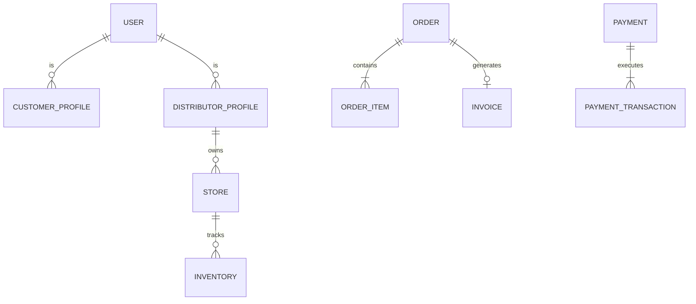
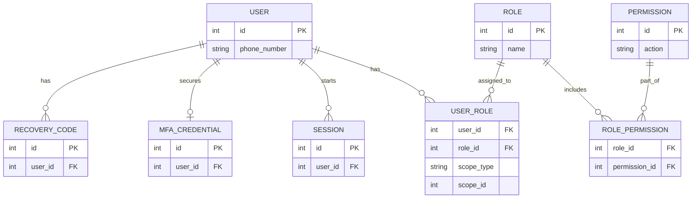
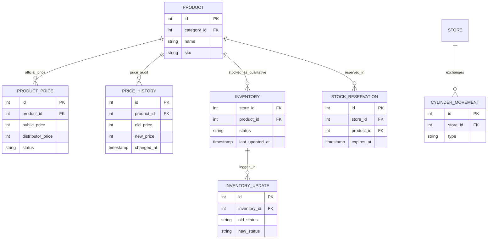
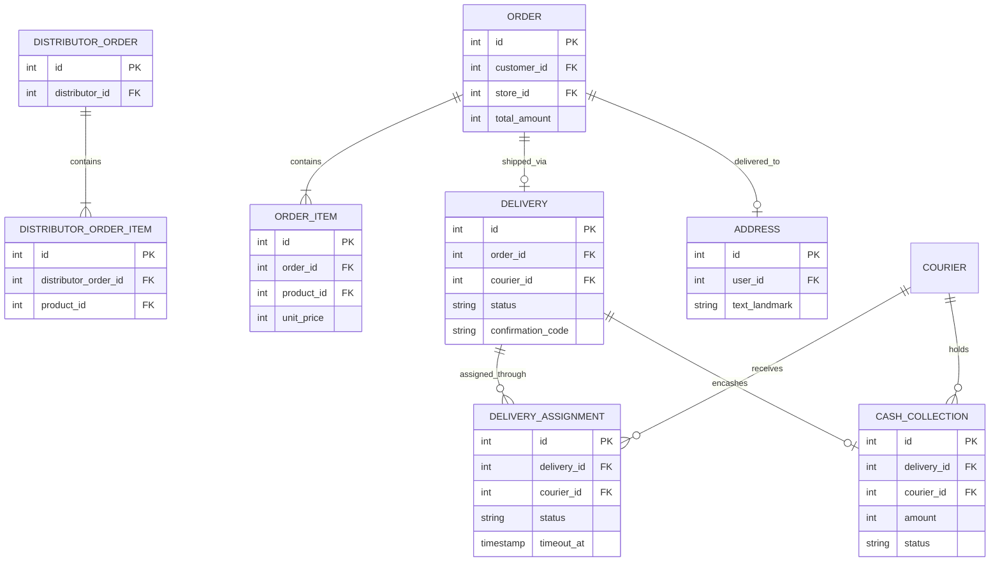
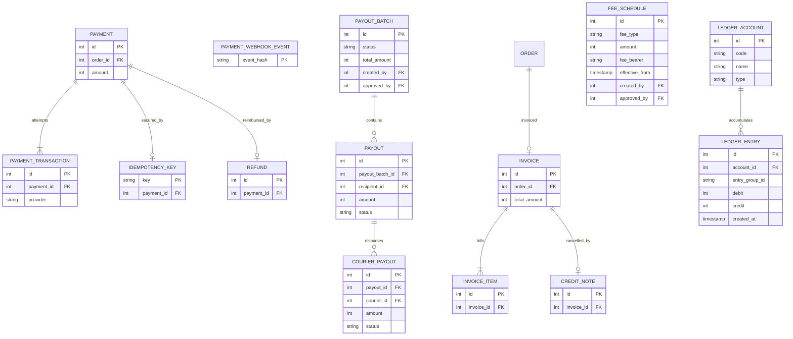
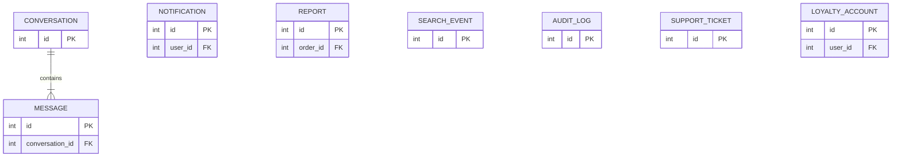

# Inventaire des Entités et ERD

Ce document dresse l'inventaire complet des entités du domaine et présente le modèle relationnel. Aucune donnée métier réelle de l'audit préliminaire n'est utilisée.

## 1. Inventaire Complet des Entités

| Domaine | Entité | Description | Clés / Relations | Données Sensibles |
|---|---|---|---|---|
| **Accès** | `User` | Compte utilisateur unique par téléphone | Clé: `id`, `phone_number` | Oui |
| **Accès** | `Role` | Rôle (ensemble de permissions) | Clé: `id` | Non |
| **Accès** | `Permission` | Permission granulaire | Clé: `id` | Non |
| **Accès** | `RolePermission` | Association Rôle-Permission | FK: `role_id`, `permission_id` | Non |
| **Accès** | `UserRole` | Rôle d'un utilisateur sur un scope (ex: une boutique) | FK: `user_id`, `role_id`, scope | Non |
| **Accès** | `CustomerProfile` | Profil d'un client | FK: `user_id` | Oui (Données pers.) |
| **Accès** | `DistributorProfile` | Profil d'un distributeur propriétaire | FK: `user_id` | Oui |
| **Accès** | `StaffProfile` | Profil d'un employé PLEINGAZ | FK: `user_id` | Oui |
| **Accès** | `Session` | Session de connexion | FK: `user_id` | Oui (Token) |
| **Accès** | `MfaCredential` | Identifiant TOTP (double facteur) | FK: `user_id` | Oui |
| **Accès** | `RecoveryCode` | Code de secours MFA | FK: `user_id` | Oui |
| **Réseau** | `DistributorApplication` | Dossier de candidature | FK: `distributor_id` | Oui |
| **Réseau** | `DistributorDocument` | Pièce justificative KYC restreinte aux 3 types : `ID_CARD_FRONT`, `ID_CARD_BACK`, `PORTRAIT_PHOTO`, `SHOP_PHOTO` (CR-001 D-04) | FK: `distributor_id` | Oui (CNI, etc.) |
| **Réseau** | `Store` | Boutique physique (un distributeur peut en avoir 0..N) | FK: `distributor_id` | Non |
| **Réseau** | `StoreLocation` | Coordonnées géographiques de la boutique | FK: `store_id` | Non |
| **Réseau** | `StoreHours` | Horaires d'ouverture | FK: `store_id` | Non |
| **Réseau** | `StoreStaff` | Sous-compte pour le personnel de la boutique | FK: `store_id`, `user_id` | Oui |
| **Logistique** | `Courier` | Livreur plateforme indépendant supervisé par l'administration (CR-001 D-05) | FK: `user_id` | Oui |
| **Logistique** | `CourierZone` | Zone géographique d'intervention déclarée du livreur | FK: `courier_id` | Non |
| **Logistique** | `CourierAvailability` | Disponibilité opérationnelle en temps réel (en ligne / hors ligne) | FK: `courier_id` | Non |
| **Logistique** | `DeliveryAssignment` | Proposition, timeout et acceptation d'une mission de livraison | FK: `delivery_id`, `courier_id` | Non |
| **Logistique** | `CashCollection` | Suivi des espèces collectées à la livraison et créance envers PLEINGAZ | FK: `delivery_id`, `courier_id` | Oui (Fonds) |
| **Catalogue** | `ProductCategory` | Catégorie de produit officiel PLEINGAZ (ex: 12.5kg, Accessoires) | Clé: `id` | Non |
| **Catalogue** | `Product` | Produit du catalogue officiel PLEINGAZ (zéro marque tierce - CR-001 D-01) | FK: `category_id` | Non |
| **Catalogue** | `ProductPrice` | Tarification officielle centralisée avec validité temporelle (Maker-Checker) | FK: `product_id` | Non |
| **Catalogue** | `PriceHistory` | Historique audité et opposable des changements de prix catalogue | FK: `product_id` | Non |
| **Catalogue** | `StoreProductOffer` | *Déclassé / inactif* : les prix sont obligatoirement nationaux (CR-001 D-01) | FK: `store_id`, `product_id` | Non |
| **Stock** | `Inventory` | Déclaration qualitative du stock (`BON`/`MOYEN`/`FAIBLE`/`RUPTURE`) | FK: `store_id`, `product_id` | Non |
| **Stock** | `InventoryUpdate` | Historique des déclarations de stock avec horodatage de fraîcheur | FK: `inventory_id` | Non |
| **Stock** | `StockReservation` | Blocage temporaire d'une unité pour une commande | FK: `order_id`, `product_id`, `store_id` | Non |
| **Stock** | `CylinderMovement` | Traçabilité et gestion des consignes (Entrées/Sorties de bouteilles) | FK: `store_id`, `order_id` | Non |
| **Commande** | `Order` | Commande passée par un client | FK: `customer_id`, `store_id` | Oui |
| **Commande** | `OrderItem` | Ligne de la commande client (strictement liée à `Product`) | FK: `order_id`, `product_id` | Non |
| **Commande** | `DistributorOrder` | Commande passée par un distributeur à un grossiste | FK: `distributor_id` | Non |
| **Commande** | `DistributorOrderItem`| Ligne de la commande distributeur | FK: `distributor_order_id`, `product_id`| Non |
| **Commande** | `Delivery` | Processus de livraison avec code de confirmation client obligatoire | FK: `order_id`, `courier_id` | Oui (GPS) |
| **Commande** | `Address` | Adresse et repère texte pour la livraison locale | FK: `user_id` | Oui |
| **Finance** | `Payment` | Tentative ou succès de règlement | FK: `order_id` | Oui |
| **Finance** | `PaymentTransaction` | Traçabilité technique et frais de l'opérateur (fee_bearer) | FK: `payment_id` | Oui |
| **Finance** | `IdempotencyKey` | Verrou contre les double-paiements | FK: `payment_id` | Non |
| **Finance** | `PaymentWebhookEvent` | Trace pour rejeu des webhooks opérateurs | Clé: `event_hash` | Non |
| **Finance** | `Invoice` | Facture globale de la commande émise par la plateforme | FK: `order_id`, `vendor_id` | Non |
| **Finance** | `InvoiceItem` | Ligne de la facture | FK: `invoice_id` | Non |
| **Finance** | `InvoiceSequence` | Compteur de numérotation séquentielle par vendeur | Clé: `vendor_id` | Non |
| **Finance** | `CreditNote` | Avoir d'annulation ou de remboursement (Immuable) | FK: `invoice_id` | Non |
| **Finance** | `Refund` | Remboursement d'un paiement (ex: LATE_SUCCESS) | FK: `payment_id` | Oui |
| **Finance** | `Settlement` | Processus de règlement des créances/dettes | FK: `vendor_id` | Non |
| **Finance** | `Payout` | Virement individuel de reversement | FK: `settlement_id` | Non |
| **Finance** | `PayoutBatch` | Lot de reversement groupé validé en Maker-Checker (CR-001 D-06) | Clé: `id` | Non |
| **Finance** | `LedgerAccount` | Compte du grand livre immuable (Actif, Passif, Charge, Produit) | Clé: `id`, `code` | Non |
| **Finance** | `LedgerEntry` | Écriture à partie double immuable (`SUM(debit)==SUM(credit)`) | FK: `account_id`, `entry_group_id` | Non |
| **Finance** | `DeliveryFeeSchedule` | Barème versionné des frais de livraison et commissions | Clé: `id` | Non |
| **CRM** | `Conversation` | Fil de discussion (Support ou Distributeur/Client) | Clé: `id` | Oui |
| **CRM** | `Message` | Message dans une conversation | FK: `conversation_id` | Oui |
| **CRM** | `Notification` | Alerte utilisateur (App/Email/SMS) | FK: `user_id` | Oui |
| **CRM** | `NotificationPreference`| Préférences et opt-in de notification | FK: `user_id` | Non |
| **CRM** | `Review` | Avis laissé par le client | FK: `order_id`, `store_id` | Non |
| **CRM** | `Favorite` | Boutique ou produit favori | FK: `user_id` | Non |
| **CRM** | `SupportTicket` | Demande d'assistance | FK: `user_id` | Oui |
| **CRM** | `KnowledgeDocument` | Fiche d'aide (ex: sécurité gaz) | Clé: `id` | Non |
| **CRM** | `Report` | Signalement ou litige | FK: `reporter_id`, `order_id` | Oui |
| **Analytics**| `SearchEvent` | Recherches géographiques anonymisées (coarse_area, zéro GPS exact) | Clé: `id` | Non |
| **Analytics**| `AuditLog` | Trace d'une action sensible immuable | FK: `user_id` | Oui |
| **Analytics**| `StockAlert` | Alerte seuil de stock déclenchée | FK: `store_id`, `product_id` | Non |
| **Analytics**| `DemandAlert` | Alerte de rupture (demande insatisfaite) | FK: `store_id`, `product_id` | Non |
| **Analytics**| `Promotion` | Règle de réduction gouvernée exclusivement par l'Admin | Clé: `id` | Non |
| **Analytics**| `LoyaltyAccount` | Compte de points de fidélité | FK: `user_id` | Non |
| **Analytics**| `LoyaltyTransaction` | Gain ou dépense de points | FK: `loyalty_account_id` | Non |
| **Admin** | `Setting` | Paramètres applicatifs (délais, plafonds de caisse, rayons) | Clé: `key` | Non |

*Entités neutralisées / ajustées : L'entité `StoreProductOffer` est déclassée au profit du catalogue centralisé `ProductPrice`. `Courier` devient une entité autonome de premier rang rattachée à `User` (CR-001 D-05). Le grand livre immuable `LedgerAccount` / `LedgerEntry` est introduit pour la rigueur financière (CR-001 D-06).*

---

## 2. Diagrammes d'Entité-Relation (ERD)

### 2.1 ERD Global Simplifié


### 2.2 ERD 1 : Utilisateurs, Accès et Profils


### 2.3 ERD 2 : Réseau et Distributeurs
```mermaid
erDiagram
    DISTRIBUTOR_PROFILE {
        int id PK
        int user_id FK
    }
    STORE {
        int id PK
        int distributor_id FK
    }
    STORE_LOCATION {
        int id PK
        int store_id FK
        geometry point
    }
    STORE_HOURS {
        int id PK
        int store_id FK
    }
    STORE_STAFF {
        int user_id FK
        int store_id FK
    }
    DISTRIBUTOR_APPLICATION {
        int id PK
        int distributor_id FK
    }
    DISTRIBUTOR_DOCUMENT {
        int id PK
        int distributor_id FK
        string document_type
    }
    COURIER {
        int id PK
        int user_id FK
        string status
        string vehicle_type
    }
    COURIER_ZONE {
        int id PK
        int courier_id FK
        string city
        string area_name
    }
    COURIER_AVAILABILITY {
        int courier_id PK_FK
        boolean is_online
        timestamp last_seen_at
    }
    DISTRIBUTOR_PROFILE ||--o{ STORE : "owns"
    STORE ||--o| STORE_LOCATION : "has"
    STORE ||--o{ STORE_HOURS : "opens_during"
    STORE ||--o{ STORE_STAFF : "employs"
    DISTRIBUTOR_PROFILE ||--o| DISTRIBUTOR_APPLICATION : "submits"
    DISTRIBUTOR_PROFILE ||--o{ DISTRIBUTOR_DOCUMENT : "provides_3_docs_only"
    USER ||--o| COURIER : "operates_as"
    COURIER ||--o{ COURIER_ZONE : "covers"
    COURIER ||--o| COURIER_AVAILABILITY : "tracks"
```

### 2.4 ERD 3 : Catalogue et Stock (CR-001 D-01)

*Note : L'entité historique `STORE_PRODUCT_OFFER` est neutralisée : les prix sont exclusivement gouvernés par `PRODUCT_PRICE` centralisé (CR-001 D-01).*

### 2.5 ERD 4 : Commandes et Livraison (CR-001 D-05)


### 2.6 ERD 5 : Paiements, Factures, Grand Livre et Reversements (CR-001 D-06)


### 2.7 ERD 6 : Communication, IA et Analytics


## 5. Métriques calculées
- Charge actuelle
- Taux de commandes honorées
- Fiabilité des données/fraîcheur
- Délai de réponse

## 6. Entités supplémentaires
- Favorite
- Conversation
- Message
- Report
- DemandAlert
- StockReservation
- Settlement
- Store (capacité estimée)
- DistributorApplication (capacité estimée)
- Setting (coordonnées de contact, seuils de caisse, rayons géographiques)
- CourierZone (zone géographique d'intervention du livreur — CR-001 D-05)
- CourierAvailability (disponibilité opérationnelle temps réel — CR-001 D-05)
- DeliveryAssignment (affectation, timeout et acceptation de course — CR-001 D-05)
- CashCollection (suivi des espèces encaissées à la remise — CR-001 D-05, D-06)
- LedgerAccount (plan de comptes immuable — CR-001 D-06)
- LedgerEntry (écritures à double entrée équilibrées Insert-Only — CR-001 D-06)
- PayoutBatch (lots de reversement groupés Maker-Checker — CR-001 D-06)
- DeliveryFeeSchedule (barème versionné des frais de livraison — CR-001 D-05, D-06)

