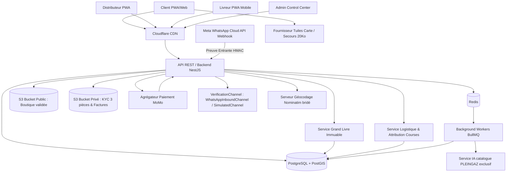
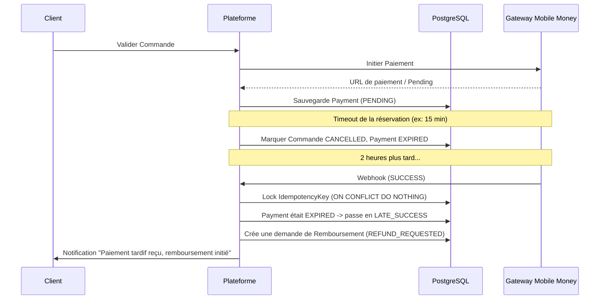
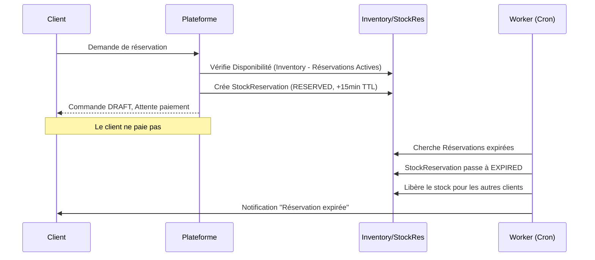
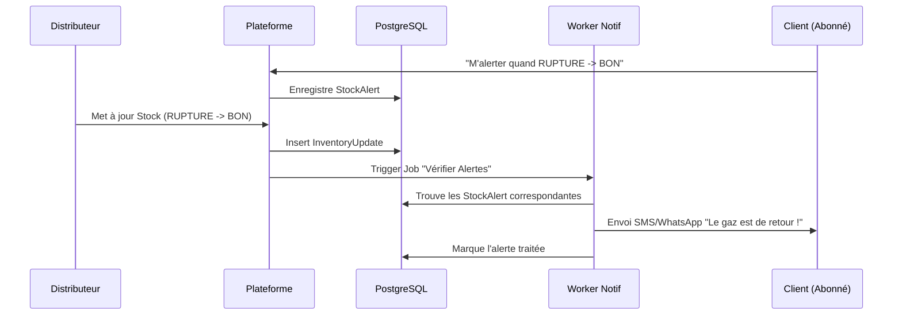
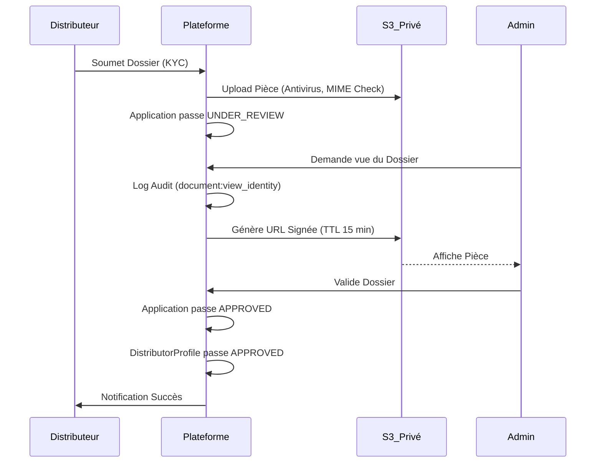
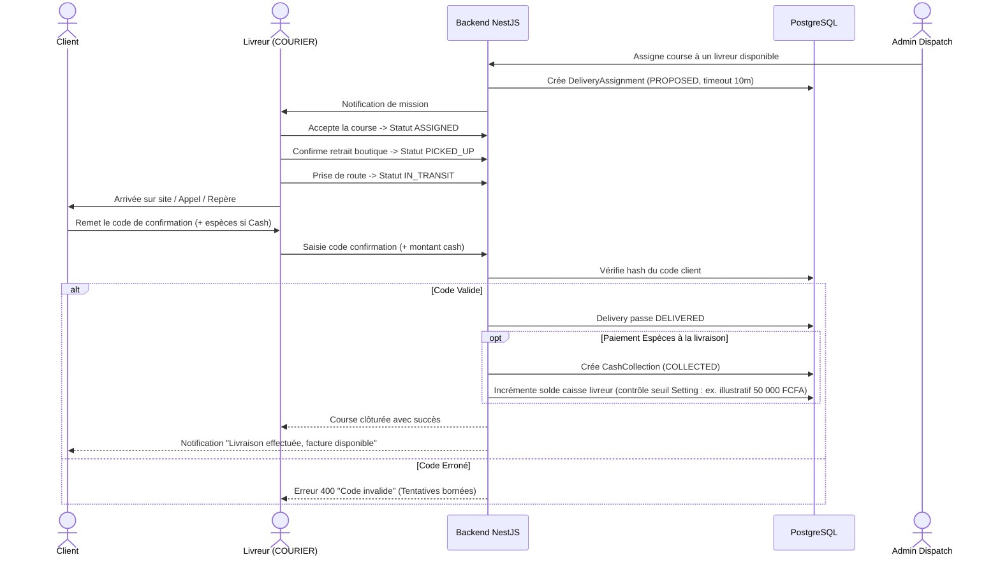
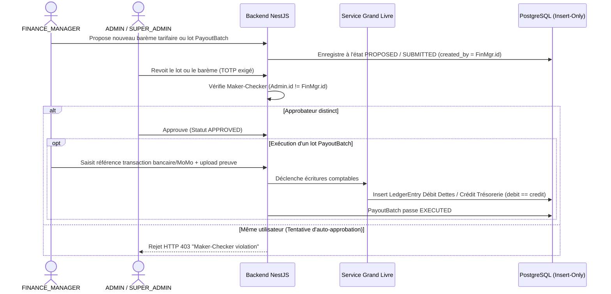
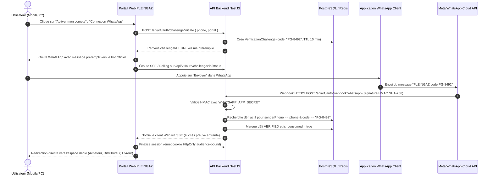

# Architecture Technique

## 1. Diagramme d'Architecture Globale

## 2. Hébergement et CDN (ADR D2)
**Statut de l'ADR D2 : PROPOSÉ.**
La plateforme doit équilibrer les coûts et la performance depuis le Cameroun.
- **Option A : Hébergement local/régional (ex: Afrique du Sud)**. Latence très faible (50-80ms). Coût élevé, facturation en devise locale (XAF) rare ou premium USD, support variable, conformité forte des données (souveraineté locale).
- **Option B : VPS Européen + Cloudflare (Recommandation de conception)**. Latence API moyenne (120-150ms depuis le Cameroun), mais statiques servis très rapidement via le cache edge de Cloudflare. Coût faible/moyen, facturation en EUR/USD, support mondial robuste, conformité à analyser (transfert de données).
- **Décision** : Le choix est laissé au client, l'Option B est recommandée pour le MVP.
- **Paramétrage Cloudflare** : Anti-bot configuré pour ne pas bloquer les vrais utilisateurs/API. Origine verrouillée sur le trafic CDN. IP réelle via `True-Client-IP`.

## 3. Stratégie de Cache (TTL et Durée de cache)
Il est critique de séparer les contenus statiques des contenus dynamiques (stock, données privées).
- **Statiques (CSS, JS, Fonts)** : Durée de cache longue (1 an) avec invalidation par hash de fichier.
- **Images publiques** : Durée de cache de 30 jours au niveau du CDN.
- **Pages Vitrines (SSR Next.js)** : Pré-rendues avec ISR (Incremental Static Regeneration). Durée de cache/TTL de 1 heure.
- **Blocs Dynamiques (ex: Stock d'un point de vente)** : Le squelette de la page du distributeur est en cache, mais **le bloc affichant le stock est toujours chargé dynamiquement (Client-Side Fetch)** et porte un TTL de 0 seconde (pas de cache). Il affiche systématiquement la "date de dernière mise à jour".
- **Données Sensibles (Factures, Profils, KYC)** : En-têtes HTTP `Cache-Control: no-store, no-cache, max-age=0`.
- **Redis** : Utilisé pour les caches temporaires (TTL courts, ex: 5 min pour une recherche sans géolocalisation), le rate limiting et le TTL des défis WhatsApp `VerificationChallenge` (10 minutes). **Règle absolue : jamais de données qui doivent survivre à un redémarrage.**

## 4. API REST et Recherche (CR-001 D-01, D-02)
- **Standards** : API versionnée (`/api/v1`). Documentation OpenAPI (Swagger) générée automatiquement depuis le code. Erreurs standardisées (RFC 7807), CORS restrictif. 
- **Politique de Versionnement** : Ajouts permis. Casseurs de compatibilité = `/api/v2`. Dépréciation annoncée 6 mois à l'avance via un en-tête `Deprecation: true`.
- **Rate Limiting** : Limites strictes par endpoint via Redis pour contrer le flood :
  - `POST /api/v1/auth/challenge/initiate` (Génération défi) : 3/heure par IP.
  - `POST /api/v1/auth/login` (Connexion) : 10/heure par IP et par compte.
  - `GET /stores/search` (Recherche) : 30/minute.
  - `POST /geo/geocode` (Géocodage backend) : 1/seconde max par session/IP.
  - `POST /orders` (Création de commande) : 5/heure.
  - `POST /webhooks/*` : 100/minute (avec vérification stricte de signature).
- **Architecture de Recherche Respectueuse de la Vie Privée (CR-001 D-02)** :
  - **Déclenchement au clic uniquement** : L'API `navigator.geolocation` n'est jamais appelée au chargement. Elle est sollicitée uniquement suite au clic explicite sur "Ma position" ou "J'ai besoin de gaz", précédé de la mention de transparence. HTTPS obligatoire.
  - **Primauté du choix manuel** : L'utilisateur peut à tout instant chercher par Ville -> Quartier, par repère textuel ("en face de..."), ou par marqueur sur carte Leaflet.
  - **Spécification des 8 états IHM** : Gestion complète côté frontend et backend (autorisation accordée, chargement avec timeout 8s, refus utilisateur, GPS indisponible, faible précision, hors Cameroun, zéro distributeur dans le rayon, réseau faible avec bascule sur liste de secours textuelle 20 Ko).
  - **Anonymisation SearchEvent** : Seule la zone grossière (`coarse_area`, ville/quartier ou maille 1 km) est persistée à des fins d'analyse de la demande. Zéro latitude/longitude fine conservée. Pas de géolocalisation par adresse IP. Rayon par défaut de 5 km configuré dans `Setting`.
- **Catalogue Exclusif (CR-001 D-01)** : Les requêtes de recherche ne portent que sur les références officielles PLEINGAZ. Recalcul systématique des prix par le serveur depuis `ProductPrice`.

## 5. Stockage S3 et Fichiers Sécurisés (CR-001 D-04)
- **S3 Public** : Logos officiels PLEINGAZ et photos de boutiques (`SHOP_PHOTO`) transférées uniquement après validation `APPROVED`.
- **S3 Privé (Chiffré au repos)** :
  - Pièces d'identité du KYC distributeur restreintes strictement aux 3 types : `ID_CARD_FRONT`, `ID_CARD_BACK`, `PORTRAIT_PHOTO`.
  - Factures PDF immuables.
- **Sécurité et Traitement des Uploads** :
  - Compression locale côté client (Canvas HTML5 / WebP) avant transfert sur réseaux mobiles instables.
  - **Purge systématique des métadonnées EXIF** (coordonnées GPS, modèle de smartphone) côté serveur avant enregistrement définitif.
  - Analyse antivirus et vérification des magic bytes (JPEG, PNG, WebP uniquement).
  - Accès aux pièces d'identité strictement restreint aux administrateurs habilités (`document:view_identity`) via des **URL signées éphémères (TTL de 15 minutes)**, avec journalisation obligatoire dans `AuditLog`.

## 6. Frontend, PWA et Gestion de la Faible Connexion (CR-001 D-05)
- **Architecture** : Next.js (SSR / PWA). Séparation en 4 espaces : Public/Client, Distributeur, Livreur (`/courier`), Control Center Admin.
- **Espace Livreur Mobile (CR-001 D-05)** :
  - PWA ultra-légère optimisée pour smartphones d'entrée de gamme Android.
  - Mode hors ligne partiel : mémorisation de la mission active et synchronisation différée.
  - Interface axée sur l'action : bouton d'appel/WhatsApp client, bouton de signalement d'état (`PICKED_UP`, `IN_TRANSIT`), et **saisie obligatoire du code de confirmation** remis par le client pour marquer la course `DELIVERED`.
- **Offline / PWA (Mode faible connexion)** : 
  - Service Workers pour le cache des assets vitaux.
  - Sauvegarde locale d'une commande interrompue pour reprise automatique.
  - Affichage explicite des états hors-ligne ("*Vous êtes hors ligne, données potentiellement anciennes*").
  - **Mise à jour de stock Distributeur hors ligne** : Le distributeur modifie qualitativement son stock (`BON`/`MOYEN`/`FAIBLE`/`RUPTURE`) sans réseau. L'action est stockée dans IndexedDB avec l'horodatage réel de saisie et envoyée à la reconnexion.

## 7. Cartographie, Géocodage et Tuiles (ADR D3, CR-001 D-02)
**Statut de l'ADR D3 : PROPOSÉ.**
- **Géocodage Bridé** : Nominatim utilisé en backend via file d'attente (1 req/sec max par IP/session, cache local PostGIS, User-Agent identifié). Interface `GeocodingProvider` pour substitution ultérieure. Pas d'autocomplétion à la frappe.
- **Tuiles de la carte et Poids Data** : Une vue cartographique consomme environ 1.5 Mo. En cas de réseau bridé (3G), d'erreur de chargement ou de refus de géolocalisation, bascule immédiate sur la **liste de secours textuelle** (~20 Ko JSON pur) ordonnée par quartier ou distance approximative.

## 8. Tâches en Arrière-plan (Workers)
Gestion des processus asynchrones via files d'attente (ex: BullMQ sur Redis).
- **Files** : Notifications, PDF generation, Webhooks de paiement, Expiration des réservations, Alertes de stock.
- **Résilience** : Reprises automatiques (retries exponentiels), exécution garantie de manière idempotente.
- **File des échecs (Dead Letter Queue)** : Les tâches ayant échoué N fois tombent dans une *dead letter queue* (file des échecs) qui déclenche une alerte critique (Slack/Email) pour inspection manuelle.

## 9. Budgets de Performance
L'audit a mesuré un LCP dégradé de **3,6 s** en mobile (3G bridée). L'objectif est d'atteindre un LCP **< 2,5 s**.
Pour garantir cela, des budgets de performance sont fixés et **seront contrôlés en CI** (via Lighthouse CI et bundlesize) lors de chaque Pull Request :
- **Page SANS carte (ex: Accueil, Liste)** : Poids cible < 300 Ko (gzippé), < 20 requêtes.
- **Page AVEC carte** : Poids cible < 1.5 Mo. Tuiles limitées au viewport visible, chargement paresseux (Lazy Loading).
- **LCP Cible (Slow 4G)** : < 2,5 s.

## 10. Diagrammes de Séquence (Processus Critiques)

### 10.1 Paiement Webhook, Expiration et LATE_SUCCESS

### 10.2 Commande, Réservation de Stock et Expiration

### 10.3 Mise à jour Stock et Notification de Retour en Stock

### 10.4 Validation d'un Dossier Distributeur

### 10.5 Cycle de Livraison, Code Secret Client et Caisse Espèces (CR-001 D-05)

### 10.6 Règle Maker-Checker Finance et Grand Livre à Double Entrée (CR-001 D-06)

### 10.7 Authentification par Preuve Entrante WhatsApp (Option A — CR-003 D-12, C-04)

---

## 11. Correctifs Rapides Existants (Indépendants)
Les correctifs identifiés lors de l'audit initial (notamment le comportement défectueux de Nginx renvoyant des 200 OK sur les fichiers `robots.txt` et `sitemap.xml` non trouvés) sont **indépendants de cette refonte technique globale**. Ils peuvent et doivent être corrigés immédiatement sur l'infrastructure actuelle sans attendre la migration vers Next.js.

## 12. Dépendances des ADR
Les ADR D1 à D4 sont proposés ; les ADR D5 à D10 résultent de **CR-001** ; les ADR D11 à D18 résultent de **CR-003** et prévalent sur toute disposition antérieure :

| ADR | Sujet | Statut | Choix techniques dépendants |
|---|---|---|---|
| **D1** | Migration Next.js (SSR) | PROPOSÉ | Architecture Frontend (Next.js), hébergement Node.js, pré-rendu SEO. |
| **D2** | Hébergement (VPS + CF) | PROPOSÉ | Stratégie de Cache Edge Cloudflare, latence cible, IP filtering. |
| **D3** | Tuiles de la carte | PROPOSÉ | Budget d'affichage, gestion des écrans de secours (texte pur), consommation data. |
| **D4** | Agrégateur Paiement | PROPOSÉ | Webhooks `LATE_SUCCESS`, UX de paiement redirigé vs intégré. |
| **D5** | Catalogue exclusif & Prix centralisés (CR-001 D-01) | **VALIDÉ** | Suppression marketplace, recalcul systématique serveur, restriction FK. |
| **D6** | Géolocalisation au clic & Primauté manuel (CR-001 D-02) | **VALIDÉ** | Composant sélecteur lieu, 8 états IHM, anonymisation `SearchEvent`, liste secours 20 Ko. |
| **D7** | Reporting Control Center & Zéro fictif (CR-001 D-03) | **VALIDÉ** | 15 rapports réels SQL, états vides explicites, exclusion stricte seeds démo. |
| **D8** | KYC Distributeur 3 pièces exclusives (CR-001 D-04) | **VALIDÉ** | S3 privé chiffré, URL signées 15 min, stripping EXIF systématique, checklist admin. |
| **D9** | Rôle Livreur & Code confirmation (CR-001 D-05) | **VALIDÉ** | 9e rôle RBAC `COURIER`, PWA livreur légère, attribution manuelle, suivi caisse espèces. |
| **D10**| Maker-Checker & Grand Livre immuable (CR-001 D-06) | **VALIDÉ** | Insert-Only `LedgerEntry`, débit=crédit, double signature reversements, TOTP obligatoire. |
| **D11**| Authentification obligatoire & Espaces séparés (CR-003 D-11) | **VALIDÉ** | Portails étanches (`/acheteur`, `/distributeur`, `/livreur`), URL staff masquée, 404 inter-espaces, token audience-bound. |
| **D12**| Inscription & Connexion WhatsApp gratuite (CR-003 D-12) | **VALIDÉ** | Preuve entrante (`VerificationChannel`), 2 numéros E.164 obligatoires, SimulatedChannel. |
| **D13**| Charte graphique inchangée & Design System (CR-003 D-13) | **VALIDÉ** | Respect strict couleurs (#FF0000, #FFB000) et Montserrat, ratios WCAG AA, mobile-first. |
| **D14**| Espace acheteur & Limite 5 bouteilles (CR-003 D-14) | **VALIDÉ** | Dashboard épuré, quota 5 bouteilles / fenêtre 30 jours décompté atomiquement, historique C-01. |
| **D15**| Gestionnaire de compte sans usurpation (CR-003 D-15) | **VALIDÉ** | 10e rôle `ACCOUNT_MANAGER`, action sous dossier `AccountCase` obligatoire, zéro modification directe. |
| **D16**| Registre complet & Vente au comptoir (CR-003 D-16) | **VALIDÉ** | Enregistrement `CounterSale` distributeur, confirmation acheteur, décompte quota. |
| **D17**| Double confirmation livraison & Tarifs (CR-003 D-17) | **VALIDÉ** | Bouton "J'ai livré" + "J'ai reçu", tarif PLEINGAZ fixe 1 000 F, prix libres bornés tiers. |
| **D18**| Rubrique "Infos" ciblée sur chaque espace (CR-003 D-18) | **VALIDÉ** | Annonces administratives dynamiques, ciblage rôles/zones, accusé "J'ai compris". |

## 14. Stack technique retenue
La stack de l'audit préliminaire (04-stack.md) a été validée pour le MVP, ajustée par nos ADRs :

| Domaine | Technologie | Statut |
|---|---|---|
| Langage principal | TypeScript | Retenu MVP |
| Frontend | Next.js + React | **PROPOSÉ** (ADR D1) |
| Style et interface | Tailwind CSS | Retenu MVP |
| Composants UI | shadcn/ui | Retenu MVP |
| Icônes | Lucide React | Retenu MVP |
| Backend | NestJS | Retenu MVP |
| Base de données | PostgreSQL | Retenu MVP |
| Géolocalisation | PostGIS | Retenu MVP |
| ORM | Prisma | Retenu MVP |
| Requêtes géographiques | SQL paramétré | Retenu MVP |
| Cache | Redis | Retenu MVP |
| Tâches en arrière-plan | BullMQ | Retenu MVP |
| Cartes | Leaflet + React Leaflet | **PROPOSÉ** (ADR D3) |
| Authentification | JWT + cookies HttpOnly | Retenu MVP |
| Mots de passe | Argon2id | Retenu MVP |
| Permissions | RBAC | Retenu MVP |
| Validation | Zod + ValidationPipe NestJS | Retenu MVP |
| Paiements | PaymentProvider (abstrait) | **PROPOSÉ** (ADR D4) |
| Fichiers | Stockage compatible S3 | Retenu MVP |
| Notifications | Email + WhatsApp | Retenu MVP |
| Temps réel | WebSocket / Socket.IO | Plus tard |
| Recherche initiale | PostgreSQL | Retenu MVP |
| Recherche avancée | OpenSearch | Plus tard |
| IA | LLM + RAG + outils internes | Plus tard |
| Tests unitaires | Jest | Retenu MVP |
| Tests API | Supertest | Retenu MVP |
| Tests navigateur | Playwright | Retenu MVP |
| Conteneurisation | Docker + Compose | Retenu MVP |
| Serveur | Ubuntu Linux | **PROPOSÉ** (ADR D2) |
| Reverse proxy | Nginx | Retenu MVP |
| Gestion du code | Git + GitHub | Retenu MVP |
| Monitoring | Sentry + Uptime Kuma | Retenu MVP |
