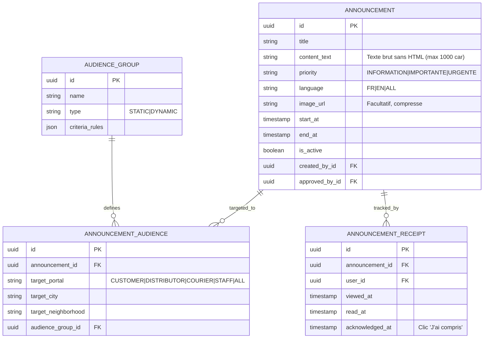

# 14g. Spécification de la Rubrique "Infos" et du Système d'Annonces Ciblées

- **Statut** : VALIDÉ (CR-003 D-18)
- **Portée** : Composant IHM "Infos" présent sur toutes les pages, ciblage d'annonces administratives et accusés de lecture obligatoires.
- **Phase cible** : MVP (Phase 2 révisée).

---

## 1. Principes et Composant IHM "Infos" sur Chaque Espace

Le système d'annonces et d'informations institutionnelles est intégré nativement dans l'ensemble des interfaces de la plateforme via un composant UI transversal dédié (D-18.1) :

1. **Présence Systématique sur Chaque Page** :
   - Dans chaque espace (Acheteur, Distributeur, Livreur, Control Center), l'en-tête de page intègre une **icône cloche / porte-voix "Infos"** surmontée d'une pastille dynamique indiquant le nombre d'annonces non lues.
   - L'appui sur l'icône déploie un **panneau latéral coulissant (Slide-over / Drawer)** répertoriant les annonces actives destinées à l'utilisateur.
   - Sur la **page d'accueil publique**, un bandeau d'information publique facultatif peut être activé pour diffuser des communiqués officiels nationaux (ex: disponibilité générale de stock, alertes météo ou jours fériés).

2. **Niveaux de Priorité et Comportement Visuel** :

| Priorité | Comportement Visuel | Accusé Exigé |
|---|---|---|
| **`INFORMATION`** (Basse) | Affiché dans le tiroir Infos avec puce bleue. Aucun blocage de l'écran. | Vu / Lu simple |
| **`IMPORTANTE`** (Moyenne) | Encart d'en-tête jaune/orange permanent sur le tableau de bord jusqu'à acquittement. | **Bouton obligatoire « J'ai compris »** pour clore le bandeau. |
| **`URGENTE`** (Haute) | **Bannière modale rouge plein écran** s'affichant immédiatement à la connexion ou lors de la navigation, bloquant les actions opérationnelles jusqu'à lecture. | **Bouton « J'ai compris et pris connaissance »** obligatoire. |

---

## 2. Modèle de Données et Entités du Système d'Annonces

1. **`Announcement`** : Définition de l'annonce, son texte, sa priorité, ses dates d'effet et ses approbations Maker-Checker.
2. **`AnnouncementAudience`** : Règles de ciblage géographique (villes, quartiers), par type d'espace opérationnel, ou par groupe.
3. **`AudienceGroup`** : Groupes statiques (listes de comptes précis) ou dynamiques (ex: *« Distributeurs sans mise à jour de stock depuis 48h »*, *« Nouveaux acheteurs inscrits depuis moins de 7 jours »*).
4. **`AnnouncementReceipt`** : Suivi nominatif horodaté prouvant la remise et la prise de connaissance de l'information.

---

## 3. Workflow de Création, Simulation et Publication (D-18.2, D-18.4)

1. **Rédaction encadrée (Anti-XSS & Poids)** :
   - Titre concis (max 120 caractères).
   - Texte au format **texte brut strict** (interdiction de balises HTML ou scripts exécutables pour garantir une sécurité absolue).
   - Pièce jointe optionnelle restreinte à une image légère (WebP/JPEG compressé < 300 Ko).
2. **Aperçu et Calcul Prédictif de Portée** :
   - Avant toute publication, l'interface administrateur calcule en temps réel le nombre exact de comptes ciblés : *« Cette annonce sera diffusée à 142 distributeurs sur Douala »*.
   - **Confirmation renforcée pour envois larges** : Si la diffusion touche plus de 1 000 utilisateurs, une confirmation de sécurité explicite avec mot de passe/TOTP est requise.
3. **Gouvernance et Séparation des Tâches** :
   - Un responsable de pôle (ex: `DISTRIBUTOR_MANAGER` pour les distributeurs, `LOGISTICS_MANAGER` pour les livreurs) peut proposer et planifier un projet d'annonce.
   - La publication effective relève de la validation formelle d'un **`ADMIN`** ou **`SUPER_ADMIN`** (Maker-Checker de communication).
   - Chaque publication fait l'objet d'un événement tracé dans `AuditLog`.

---

## 4. Statistiques de Portée et Règle de Non-Immixtion

1. **Statistiques 100% Réelles dans le Control Center** :
   - Nombre de destinataires éligibles.
   - Taux d'impression (annonces affichées dans le tiroir).
   - Taux d'ouverture et d'acquittement ("J'ai compris").
   - Liste des comptes en retard d'acquittement pour les informations urgentes.
2. **Règle d'Étanchéité avec les Dossiers Privés (D-18.3)** :
   - Le système d'annonces ne véhicule **aucune donnée personnelle**. Il est formellement interdit de mentionner des litiges, des coordonnées personnelles ou des données bancaires dans une annonce d'audience.
   - Les communications d'assistance individuelle sont gérées exclusivement via les dossiers d'intervention privés **`AccountCase`** (D-15).

---

## 5. Endpoints du Module Infos (`/api/v1/announcements/*`)

| Méthode | Route | Rôle requis | Description |
|---|---|---|---|
| `GET` | `/api/v1/announcements/my-active` | Authentifié (Tout portail) | Liste des annonces actives ciblant l'utilisateur connecté. |
| `POST` | `/api/v1/announcements/:id/receipt` | Authentifié (Tout portail) | Enregistrement de la lecture ou du clic « J'ai compris ». |
| `GET` | `/api/v1/announcements/public-banner`| Public | Récupère le bandeau d'information publique pour la page d'accueil. |
| `POST` | `/api/v1/admin/announcements` | `ADMIN`, `DISTRIBUTOR_MANAGER` | Création et simulation d'un projet d'annonce ciblée. |
| `POST` | `/api/v1/admin/announcements/:id/publish` | `ADMIN`, `SUPER_ADMIN` | Approbation et publication effective d'une annonce. |
| `GET` | `/api/v1/admin/announcements/:id/metrics` | `ADMIN`, `COMMUNICATION_MANAGER` | Statistiques de diffusion, portée et taux d'acquittement. |
