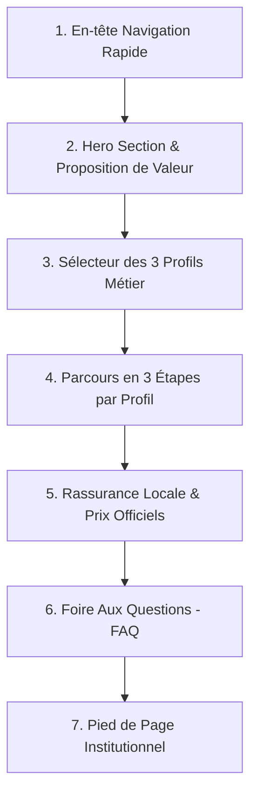

# Spécification de la Page d'Accueil Publique (Landing Page CR-003)

## 1. Objectifs & Positionnement

La page d'accueil de PLEINGAZ (`/` ou `/accueil`) est la vitrine publique officielle du service. Elle a pour vocation :
- De rassurer immédiatement les usagers camerounais sur la disponibilité et le prix officiel du gaz domestique.
- D'orienter immédiatement chaque visiteur vers son espace dédié selon son profil d'activité (Acheteur, Distributeur, Livreur).
- De convertir les visiteurs en utilisateurs enregistrés via l'authentification gratuite et instantanée par WhatsApp (D-12).
- **Sécurité et discrétion absolue (D-11 / Spécification 14b)** : Aucune mention, aucun lien, aucun bouton de connexion ne fait référence à l'espace d'administration ou au personnel interne PLEINGAZ. L'accès staff s'effectue exclusivement via une URL d'infrastructure masquée sous double facteur TOTP.

---

## 2. Structure Modulaire de la Landing Page

La page est découpée en 7 blocs verticaux logiques et fluides :

---

## 3. Détail des Sections

### 3.1. En-tête de Navigation (Navbar)
- **Logo officiel** : Logo PLEINGAZ en rouge et or (flamme stylisée).
- **Sélecteur de ville** : Badge Douala / Yaoundé (villes actives au MVP).
- **Bouton d'accès rapide** : `[ 💬 Connexion WhatsApp ]` orientant vers `/connexion`.

### 3.2. Hero Section : "Le gaz livré chez vous, au juste prix, sans tracasserie"
- **Accroche principale (H1)** : "Ne restez plus jamais à court de gaz au Cameroun."
- **Sous-titre** : "Commandez votre bouteille certifiée en 3 clics ou trouvez le dépôt agréé le plus proche de votre quartier. Livraison express à domicile."
- **Appel à l'action immédiat (CTA)** :
  - Bouton Primaire Rouge : `[ 🚀 Commander ma bouteille de gaz ]`
  - Bouton Secondaire WhatsApp : `[ 💬 Commander via WhatsApp ]`
- **Chiffres clés de confiance** :
  - *Prix officiel homologué garanti (6 500 FCFA pour 12.5 kg)*
  - *Livraison standard à 1 000 FCFA dans toute la zone desservie*
  - *Double confirmation sécurisée à la réception*

### 3.3. Les 3 Espaces Dédiés (Présentation des Profils Publics)
Trois cartes interactives mettent en valeur les trois portes d'entrée de la plateforme :

#### Profil 1 : Acheteur / Famille ("Je recharge mon gaz")
- **Promesse** : "Fini les déplacements avec la lourde bouteille sur la moto. Votre gaz arrive chez vous."
- **Parcours en 3 étapes** :
  1. *Choisissez* : Sélectionnez votre marque habituelle (Tradex, Total, Camgaz, SCTM, etc.) et le poids (6 kg, 12.5 kg).
  2. *Indiquez votre repère* : Pas besoin d'adresse compliquée, donnez votre quartier et un repère connu (carrefour, pharmacie, école).
  3. *Confirmez à la remise* : Vous ne payez et validez la commande qu'une fois la bouteille pesée et installée devant vous.

#### Profil 2 : Distributeur Agréé ("Je gère mon point de vente")
- **Promesse** : "Attirez de nouveaux clients dans votre quartier et suivez vos stocks en temps réel sans cahier éparpillé."
- **Parcours en 3 étapes** :
  1. *Activez votre boutique* : Créez votre compte professionnel gratuitement avec votre numéro WhatsApp.
  2. *Ajustez vos stocks en 1 clic* : Indiquez d'une seule touche sur mobile les bouteilles pleines prêtes à la vente.
  3. *Vendez au comptoir ou en livraison* : Encaissez vos ventes physiques en boutique et recevez des commandes de livraison sans frais fixes.

#### Profil 3 : Livreur Partenaire ("Je livre et je gagne")
- **Promesse** : "Rentabilisez vos trajets en moto en livrant des bouteilles dans votre secteur d'activité."
- **Parcours en 3 étapes** :
  1. *Inscrivez votre moto* : Enregistrez votre profil livreur certifié avec votre CNI et permis.
  2. *Recevez des courses optimisées* : Soyez notifié dès qu'un dépôt proche a une bouteille prête à livrer.
  3. *Gagnez 1 000 FCFA nets par course* : Tarif fixe transparent versé pour chaque livraison validée par double confirmation.

---

### 3.4. Rassurance Locale & Sécurité des Bouteilles
- **Normes de sécurité** : Toutes les bouteilles distribuées via PLEINGAZ sont contrôlées, équipées de joints neufs et scellées par des opercules d'origine des distributeurs agréés.
- **Transparence tarifaire absolue** : Zéro surfacturation. Le prix de la recharge est strictement le tarif légal en vigueur fixé par le Ministère du Commerce. Les frais de livraison sont fixes et connus dès la commande (1 000 FCFA).
- **Assistance locale continue** : Ligne d'assistance WhatsApp directe accessible 7j/7 pour toute question ou réclamation.

---

### 3.5. Foire Aux Questions (FAQ Ciblée)
1. **Comment s'inscrire si je n'ai pas d'ordinateur ?**
   *Réponse :* PLEINGAZ fonctionne directement sur n'importe quel smartphone. L'inscription est 100% gratuite et se fait en 15 secondes via votre application WhatsApp, sans mot de passe à mémoriser.
2. **Puis-je échanger une bouteille d'une marque contre une autre ?**
   *Réponse :* Oui, selon les règles de consignation en vigueur et la politique d'interchangeabilité de votre distributeur de quartier.
3. **Que se passe-t-il si la bouteille livrée fuit ou est défectueuse ?**
   *Réponse :* Grâce à notre protocole de double confirmation, vous vérifiez la conformité de la bouteille avec le livreur. Si vous constatez un défaut, vous refusez la livraison en un clic et le distributeur vous remplace la bouteille immédiatement sans frais.
4. **Combien de bouteilles puis-je commander par mois ?**
   *Réponse :* Pour garantir l'approvisionnement équitable des familles camerounaises et lutter contre la spéculation, les particuliers disposent d'un quota de 5 bouteilles par période glissante de 30 jours (visible sur votre jauge de compte). Les professionnels de la restauration peuvent solliciter un statut adapté auprès du support.

---

### 3.6. Pied de Page Institutionnel (Footer)
- Mentions légales, conditions générales d'utilisation (CGU) et politique de vie privée.
- Numéro officiel du support client WhatsApp.
- Rappel du respect de la réglementation sur les prix des hydrocarbures au Cameroun.
- *Strictement aucun lien d'accès administration staff.*
