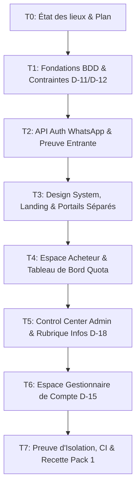

# CR-003 — Plan d'Exécution Pack 1 (T1 à T7)

**Document de Référence** : Cahier des charges `CR-003-complet` (Décisions D-11 à D-18, Règles R-01, R-02, R-03)  
**Branche** : `feat/cr003-pack1`  
**Autorisation** : Validée par le propriétaire pour exécution de bout en bout sans arrêt intermédiaire de validation.

---

## 1. Vue d'Ensemble et Principes Souverains

- **R-01 INVISIBILITÉ** : Étanchéité absolue inter-espaces. Réponse HTTP 404 systématique lors de toute tentative de franchissement de frontière. Zéro mention d'autres profils dans les IHM clientes.
- **R-02 DESIGN CONSERVÉ** : Respect strict des couleurs d'origine (`#DC2626` / `#FF0000`, `#FFB000`, Blanc, Fond Sombre/Neutre) et typographie Montserrat.
- **R-03 GRATUITÉ** : Zéro coût d'infrastructure SMS pour l'utilisateur au MVP (Preuve WhatsApp entrante, zéro SMS sortant payant).

---

## 2. Ordre des Tâches du Pack 1

---

## 3. Détail et Périmètre des Tâches T1 à T7

### **T1 : Fondations conformes aux décisions D-11 et D-12**
- **Schéma Prisma & Migration** :
  - `User.space_type` (`CUSTOMER`, `DISTRIBUTOR`, `COURIER`, `ACCOUNT_MANAGER`, `STAFF`).
  - `whatsapp_e164` UNIQUE (1 numéro WhatsApp = 1 seul type d'espace).
  - `secondary_e164` distinct du numéro principal avec contrainte CHECK SQL.
  - `VerificationChallenge` persisté en PostgreSQL avec `session_binding` et hash code sous Argon2id.
  - `AuditLog` en ajout seul (*append-only*) verrouillé par trigger SQL interdisant tout `DELETE` et `UPDATE`.
  - Tables métier minimales acheteur : `ProductCategory`, `Product`, `Store`, `Inventory`, `Order`, `OrderItem`, `Favorite`, `StockAlert`.
- **Livrables & Tests** : Migration SQL, triggers, seed de référence (`buyer_bottle_limit = 5`), tests de contraintes DB.

### **T2 : API d'authentification par WhatsApp (gratuite)**
- **Endpoints unifiés par espace** : `/api/v1/{space}/auth/...` (`register/start`, `challenges/:id/status`, `register/complete`, `login`, `refresh`, `logout`, `recovery/*`, `me`).
- **Canal de preuve entrante** : Défi inverse affiché sur écran -> lien `wa.me` -> webhook Meta ou `SimulatedChannel` (dev) -> validation automatique par polling.
- **Sécurité** : Cookie HttpOnly audience-bound (`aud`), limitation de débit Redis, protection CSRF, isolation 404 inter-espaces.

### **T3 : Identité visuelle, page d'accueil et portails**
- **Design Tokens** : Extraction rigoureuse des valeurs de marque de `monpleingaz.com`, fichier de tokens CSS, `docs/design/baseline.md`.
- **Pages Publiques** : Landing page pédagogique en 3 étapes, réassurance, bouton direct "Je suis acheteur", lien discret "Espace professionnel" sans fuite d'informations.
- **Portails dédiés** : Inscription/connexion `/acheteur`, `/distributeur`, `/livreur`, accès staff masqué (`STAFF_PORTAL_PATH`).

### **T4 : Espace acheteur et tableau de bord**
- **Navigation étanche 5 entrées** : Accueil, Trouver du gaz, Mes commandes, Mes factures, Aide (zéro mention de distributeur/livreur).
- **Tableau de bord** : Jauge de quota calculée côté serveur (fenêtre glissante 30 jours, plafond 5 bouteilles), commande express 1-clic, distributeur habituel, alertes de réapprovisionnement, panneau Infos ciblées.

### **T5 : Control Center administrateur et rubrique Infos**
- **Supervision 100% réelle** : Données issues de la BDD (zéro mock), authentification TOTP obligatoire sur URL masquée.
- **Module Infos (D-18)** : Création, ciblage géographique/espace, accusés de lecture obligatoires, traçabilité `AuditLog`.

### **T6 : Profil gestionnaire de compte (D-15)**
- **Assistance encadrée** : Rôle `ACCOUNT_MANAGER`, gestion exclusive par dossiers `AccountCase` (Maker-Checker).
- **Zéro mutation directe & zéro impersonation** : Masquage des identifiants et des numéros complets, impossibilité technique d'altérer les données utilisateur en direct.

### **T7 : Preuve d'isolation et contrôle qualité**
- **Audit automatisé R-01** : Tests Playwright et scans HTTP vérifiant l'invisibilité, l'absence de fuite et le retour 404 systématique.
- **CI / Build** : `pnpm lint`, `pnpm test`, `pnpm build`, rapport d'écart `cr003-ecarts.md`, pose du tag `cr003-pack1`.

---

## 4. Écarts Documentaires Notés

1. **Unicité des espaces vs multi-rôles historiques** : Le modèle antérieur tolérait un utilisateur multi-profils via un switch dans l'UI. CR-003 D-11 abolit définitivement ce sélecteur : un numéro = un espace dédié, contrôlé dès le middleware.
2. **Preuve entrante vs OTP SMS payant** : Abandon des SMS sortants au profit de la preuve entrante WhatsApp (gratuité totale pour la plateforme et l'usager).
